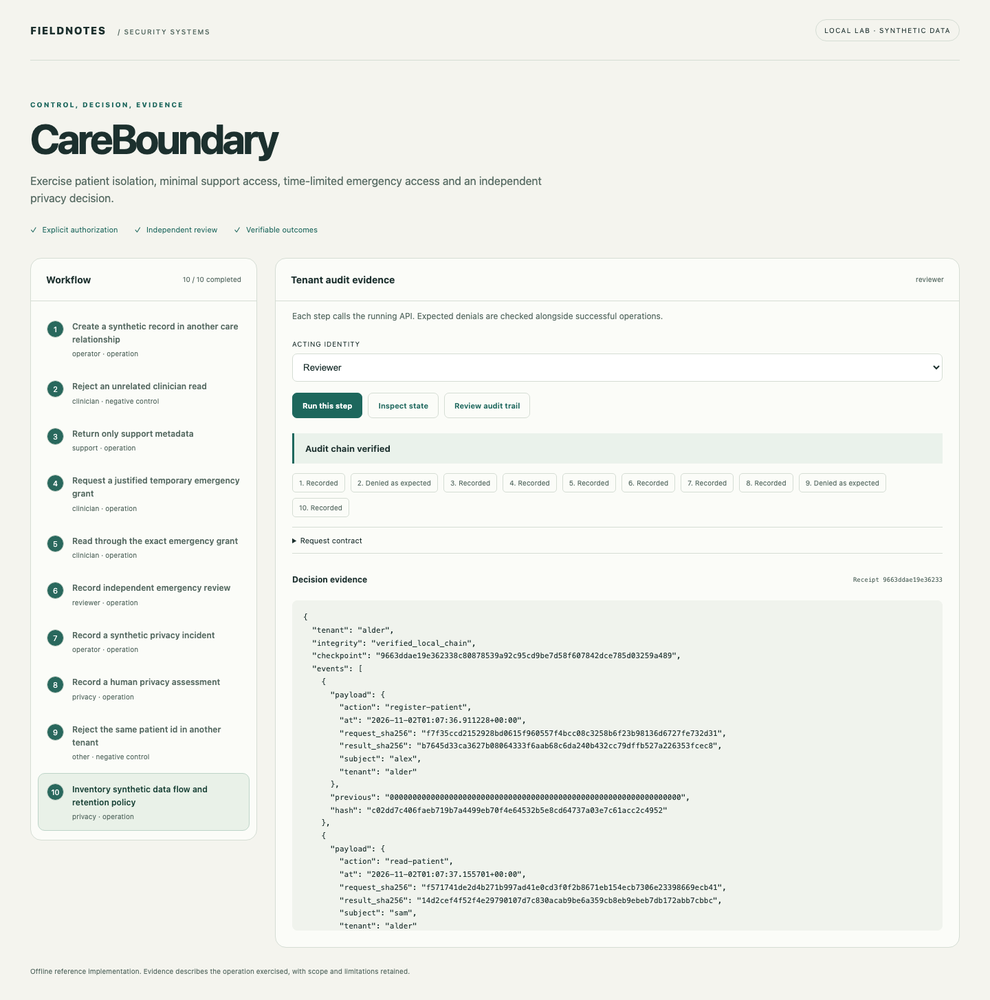
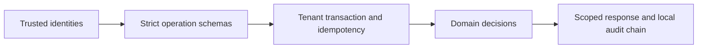

# CareBoundary

[](https://github.com/jayekwere/careboundary/actions/workflows/verify.yml) [MIT](LICENSE)

**A synthetic healthcare API with explicit patient access and reviewable emergency decisions.**

Exercise normal clinician authorization, metadata-only support reads, time-limited patient-specific emergency access, independent retrospective review and documented privacy incident assessment.



## Run locally

Python 3.14 and Node 24 through 26. Initial dependency installation requires network access. All core demonstrations run offline after setup. Each repository is independent and ships its own lockfiles.

```sh
git clone https://github.com/jayekwere/careboundary.git
cd careboundary
python3 -m venv .venv
. .venv/bin/activate
python -m pip install --require-hashes -r requirements-dev.lock
npm ci --ignore-scripts
npm run build
python -m app.cli demo
python -m app.cli serve --demo
```

Open [the local workbench](http://127.0.0.1:8080). Run steps in order. The acting identity and expected denial are visible before each operation. Each step submits a real API request, and results are rendered as text. Demo credentials are public synthetic fixtures. Use them only on the private local lab.

The CLI uses temporary state and leaves the served workbench independent. The server persists its synthetic state in `artifacts/state.db`; select a new `STATE_PATH` for a fresh exercise. CLI records use a fixed observation clock where possible. The committed sample output is generated from the executable scenario, not hand-authored findings.

```sh
docker compose up --build
# Stop and discard the temporary container workspace:
docker compose down
```

Compose publishes only to loopback. It uses a non-root UID, read-only root filesystem, dropped capabilities, a private temporary state area, a memory limit and a process limit. Temporary container state is discarded when the container is removed.

## Evidence and implementation

The data model accepts only two synthetic observation labels and rejects arbitrary clinical text, names and unsanctioned fields. Normal treatment access requires the assigned clinician subject. Support reads exclude clinical observations. An emergency grant binds its requester and one patient, lasts at most thirty minutes, tracks use and is immediately blocked by a negative independent review. It is retrospective emergency review, not prior approval. Incidents preserve sensitivity, misuse uncertainty, scope, containment and an independent human privacy decision. The fixed 730-day demonstration retention marker is documented as policy, not jurisdiction selection.



The shared architecture pattern is small Python FastAPI domain services with SQLite transactions and a TypeScript workbench. The domain logic is specific to this project. JSON input contracts reject unknown fields and type coercion. SQL is parameterized for tenant data. All state changes and successful operation receipts commit together. Replay keys bind actor, roles, action and payload. Audit events retain digests rather than request contents. Local chains detect accidental edits; a database writer can recompute a chain, so an independent checkpoint is necessary for stronger tamper evidence.

## Verify

```sh
npm run verify
python -m ruff check app tests
python -m ruff format --check app tests
python -m mypy app
python -m pytest
npx playwright install chromium
npm run test:browser
docker build -t careboundary:local .
node scripts/container-smoke.mjs careboundary:local
```

Browser tests require fresh `artifacts/browser-state.db` state. See [verification evidence](docs/verification.md), [architecture](docs/architecture.md), [threat model](docs/threat-model.md), [security design](docs/security-design.md), [API](docs/api.md) and [schemas](schemas/contracts.json). Hosted CI enforces at least 80% Python statement/branch coverage and runs browser, dependency, exact-fixture or semantic-demo, and restricted-container checks. Coverage describes executed code and is not a security score.

## Limits

Use synthetic data only. This is a small custom healthcare API, not a FHIR implementation, electronic record product or legal compliance determination. There is no real patient directory, clinical workflow, outbound notification or automated legal decision. The database is private but not encrypted by this application. The UI exposes synthetic metadata to its intended demo roles; patient clinical fields require the separate access operation. Bulk export is unsupported. Privacy decisions record an authorized human assessment and require jurisdiction-specific review before adaptation.

The service is a bounded single-node reference implementation. It supports at most 200 records per kind and 5,000 successful audit events per tenant before requiring a new workspace or deliberate archival work. Bearer identities are server-configured; there is no external identity provider, distributed scheduler, managed key service or production deployment. The offline browser interface is available only in explicit demo mode. Configured API mode requires a private identity file, accepts no demo tokens and remains intended for local evaluation. No security certification or exhaustive vulnerability guarantee is claimed.

See [SECURITY.md](SECURITY.md) and [CONTRIBUTING.md](CONTRIBUTING.md).

The privacy-scoped data-flow inventory records systems, data category, processing region, accountable owner, encryption uncertainty and configurable retention days. It produces a human-review state and never automatically determines legal jurisdiction or permits a cross-border transfer. This is a documented inventory, not active network discovery or deletion enforcement.
